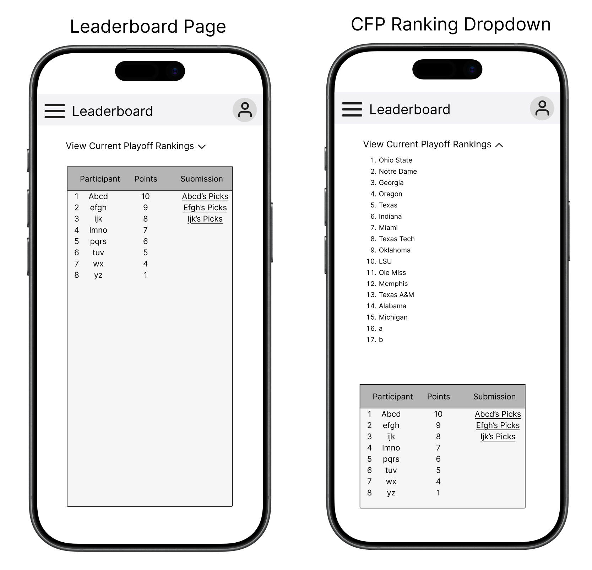

# 9/10 Meeting Notes

Drew and Tyler met to discuss adding a "Leaderboard" page to the app. See notes and action items below.

## Page Requirements

- Users should be able to see the current CFP rankings
- Users should be able to see how they're performing against others in the pool, including how many total points they have
- Users should be able to see other users' submissions, including their champion

### Mock

- Didn't get to other users' submissions, but I envision it being a closable pop-up on the Leaderboard page.


## Open Questions

- What do we fall back on if the rankings aren't out yet or the API isn't working?

## Notes

### How can we get current CFP rankings for the leaderboard? 
- Drew found [this API documentation](https://github.com/pseudo-r/Public-ESPN-API/blob/main/docs/sports/football.md) for ESPN's APIs. Seems like it's publicly available and has what we need.
- The following request retrieves the weekly CFP rankings for a given year, and includes the weeks that have been updated. Below is 2025's results so we can see real data:
  - `GET http://sports.core.api.espn.com/v2/sports/football/leagues/college-football/seasons/2024/rankings/21`
      ```json
          {
              "$ref": "http://sports.core.api.espn.com/v2/sports/football/leagues/college-football/seasons/2024/rankings/21?lang=en&region=us",
              "id": "21",
              "name": "Playoff Committee Rankings",
              "shortName": "CFP Rankings",
              "type": "cfp",
              "rankings": [
                  {
                      "$ref": "http://sports.core.api.espn.com/v2/sports/football/leagues/college-football/seasons/2024/types/2/weeks/11/rankings/21?lang=en&region=us"
                  },
                  {
                      "$ref": "http://sports.core.api.espn.com/v2/sports/football/leagues/college-football/seasons/2024/types/2/weeks/12/rankings/21?lang=en&region=us"
                  },
                  {
                      "$ref": "http://sports.core.api.espn.com/v2/sports/football/leagues/college-football/seasons/2024/types/2/weeks/13/rankings/21?lang=en&region=us"
                  },
                  {
                      "$ref": "http://sports.core.api.espn.com/v2/sports/football/leagues/college-football/seasons/2024/types/2/weeks/14/rankings/21?lang=en&region=us"
                  },
                  {
                      "$ref": "http://sports.core.api.espn.com/v2/sports/football/leagues/college-football/seasons/2024/types/2/weeks/15/rankings/21?lang=en&region=us"
                  },
                  {
                      "$ref": "http://sports.core.api.espn.com/v2/sports/football/leagues/college-football/seasons/2024/types/2/weeks/16/rankings/21?lang=en&region=us"
                  }
              ]
          }
      ```
  - Each week has a top-level `ranks` array containing the top 25 teams
    - Each object within `ranks` contains info about current ranking, previous ranking, record, and a `team.$ref` link to the team itself.

## Action Items